# 界面改版 P5 首页（新方向）改前改后截图

- 日期：2026-10-11
- 改前：main（#264 合并后）；改后：feat/ui-p5。首屏（不是整页），底部导航以上。
- 按新方向（设计 §1.1）验收：不再比首屏行数，看主角在不在首屏。首页的主角是营业状态和加油按钮，所有截图里加油按钮都完整在首屏。
- 两种状态：停业（测试号现状：油用光了）；营业（截图时拦截概况接口，改成营业、油 64%）。
- 简中 390px 浅色、深色；法文、英文、西文 360px 浅色（测试号的语言临时切过去，每张截完切回简中）。
- 所有截图横向溢出都是 0。第一轮西文 360px 头图左上的“街道 · 星级 · 天气”压在右上的“切换区服”上，改成同一个弹性行、左边截断后修好；终审后又改成只截街道、天气链接不截，资源胶囊大数字（银币 12,345,678）时换到第二行不重叠，改后的截图是终审修好后重截的。
- 开发环境的 API 用的还是旧配置（目录里没有门的图形名），截图里的门都是木门。

## 简中 390px

| 状态 | 浅色 改前 | 浅色 改后 | 深色 改后 |
|---|---|---|---|
| 停业 | 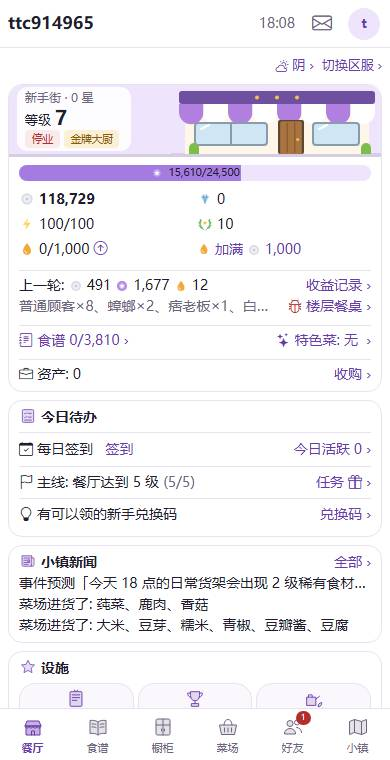 | 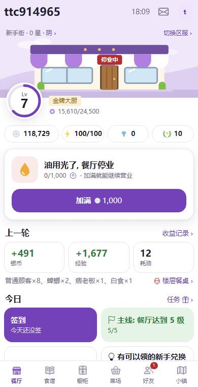 | 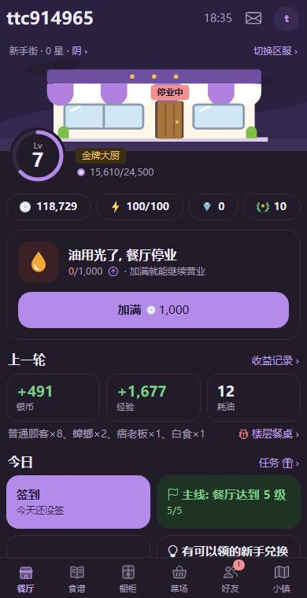 |
| 营业 | 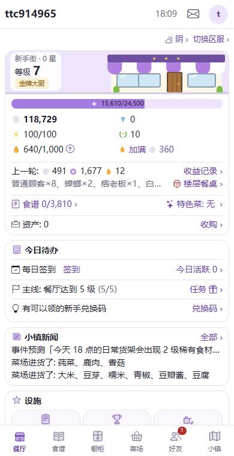 | 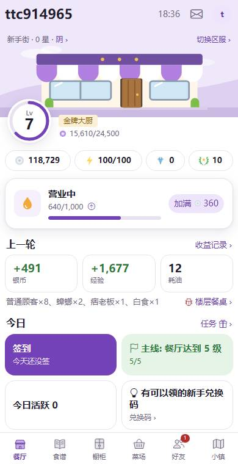 | 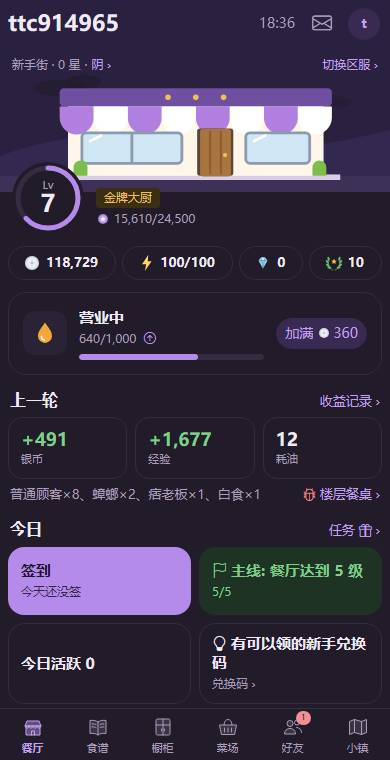 |

## 外文 360px（停业）

| 语言 | 改前 | 改后 |
|---|---|---|
| 法文 | 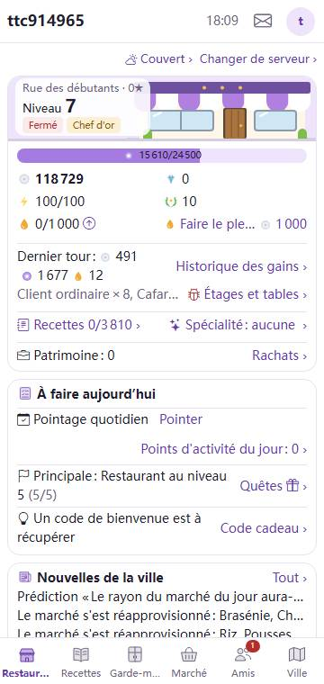 | 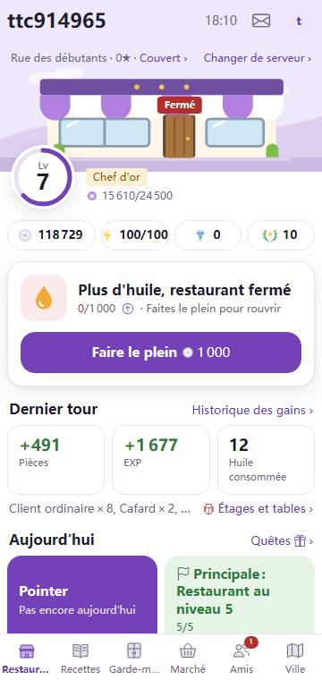 |
| 英文 | 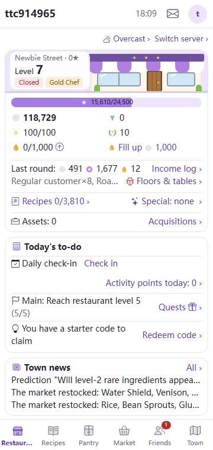 | 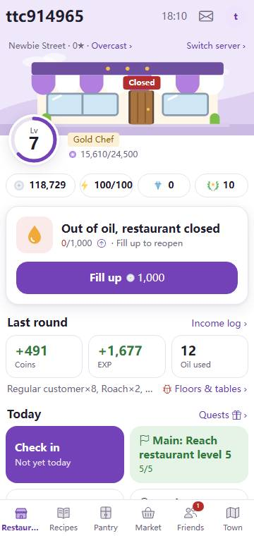 |
| 西文 | 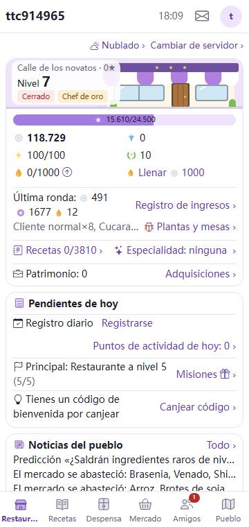 | 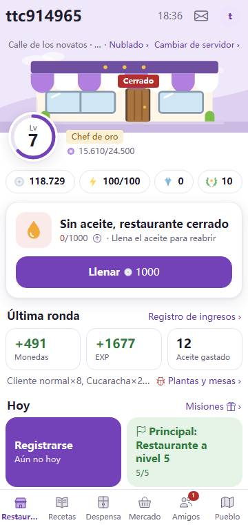 |

## 返工后整页（简中 390px，停业；截图时拦截概况接口，补上交易所大宗认购、理财到期、资产，好看提醒行的排版）

用户看过第一版指出：今日块整句加粗、交易所那几行图标文字链接混在一起、“我的店”的“收购”还是右侧文字链接、下面几块完全没改。返工后：

- 今日待办（第二轮返工，按最初定的设计）：一张卡片一行一件事——签到右边是紫色胶囊按钮，主线、今日活跃能领时右边一个“可领奖”标签，其余整行去对应页面；第一轮的 2×2 大块去掉了。
- 链接（第二轮返工，设计 §2.6）：去别处的文字链接改成紫字加点状下划线、后面不加 ›；区块标题整行可点（右边灰字和 ›），取代“全部 ›”“收益记录 ›”；楼层餐桌是一行；切换区服是头图上的小胶囊。
- 小镇新闻和餐厅动态是同一种只读行：时间 + 文字（新闻原来没有时间）；动态在卡片里不再多画一道虚线。
- 活动、交易所（大宗认购）、白食、理财到期、我的店、经营开关都用同一种行：左边图标托盘，标题和灰色副行，右边值或开关，整行可点时右边一个 ›。资产整行去收购，右边写资产数。
- 餐厅动态、小镇新闻、设施、经营开关、生效的加成都改成卡片外的区块标题。
- 设施：开了的位置一格一个；没开的收成一排小格子（图形 + “12★”），整页从 1869px 缩到 1718px。

| 浅色 | 深色 |
|---|---|
| 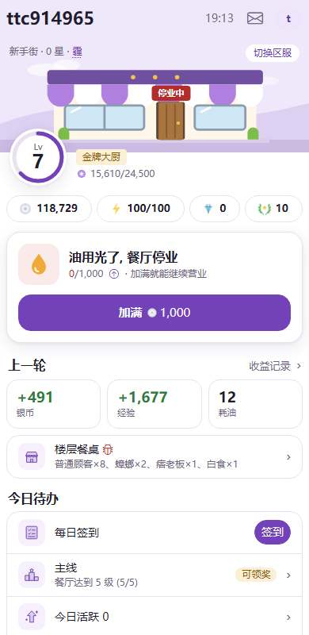 | 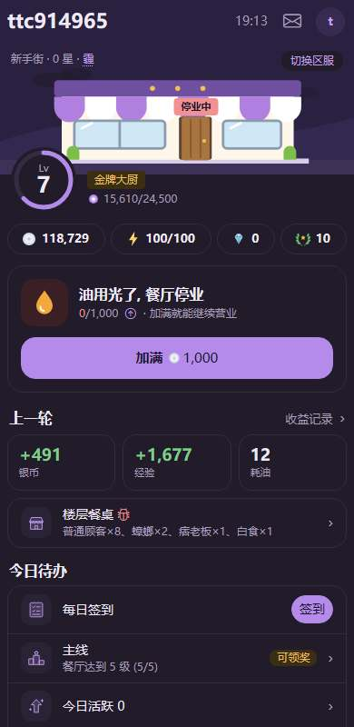 |
| 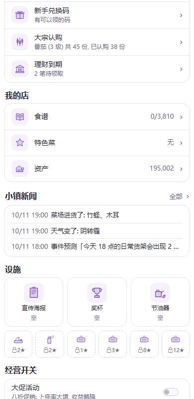 | 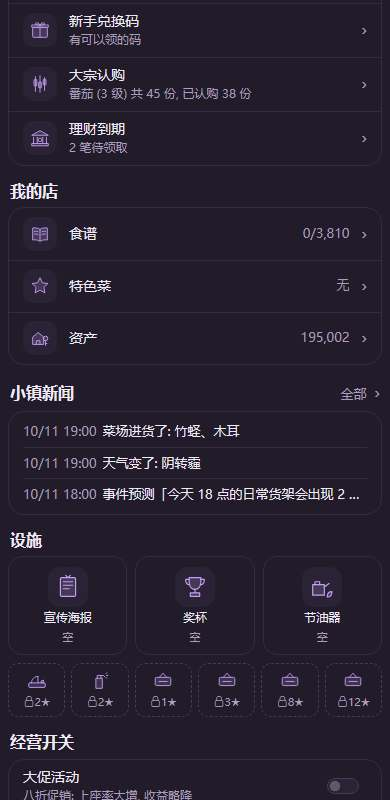 |
| 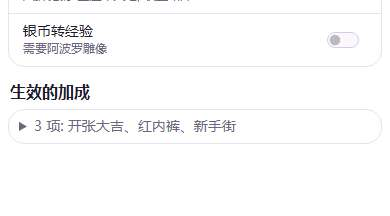 | 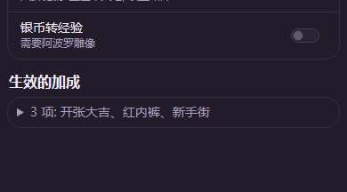 |
