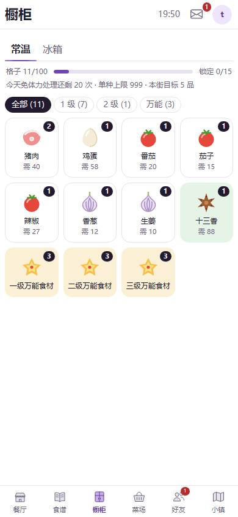
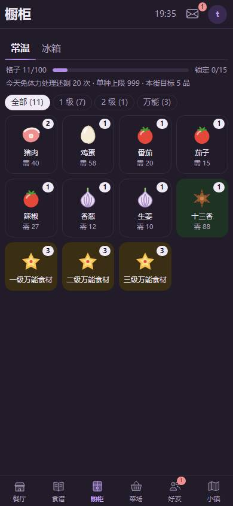
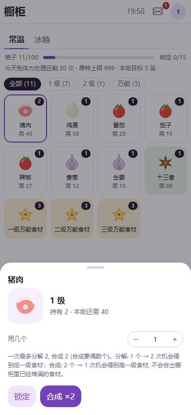
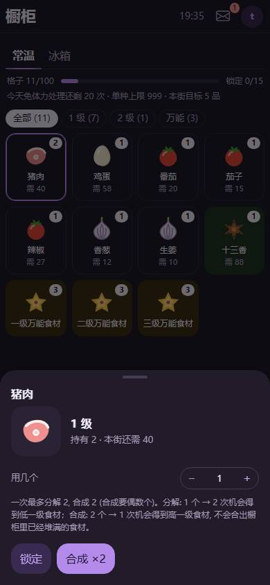
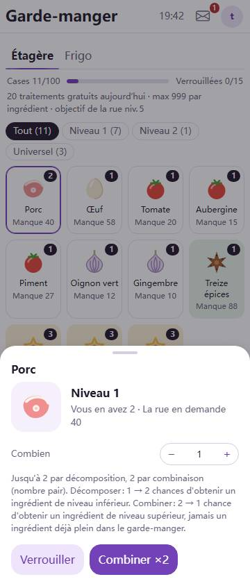
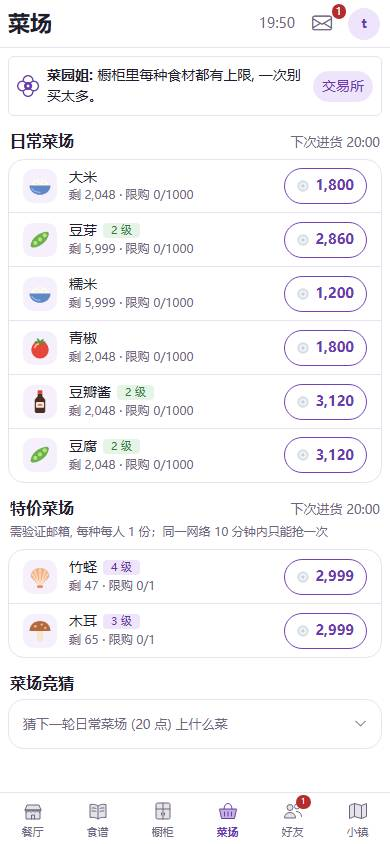
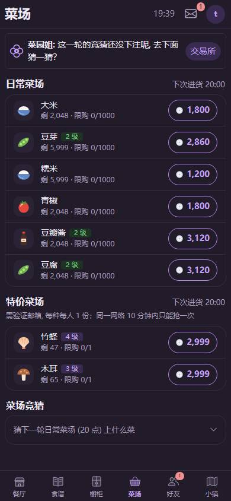
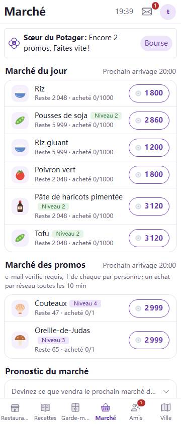
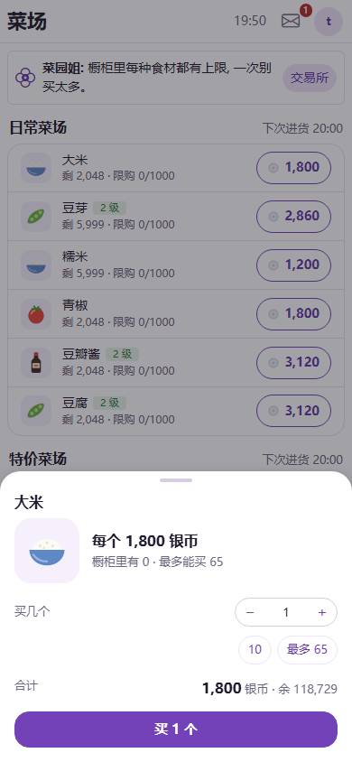
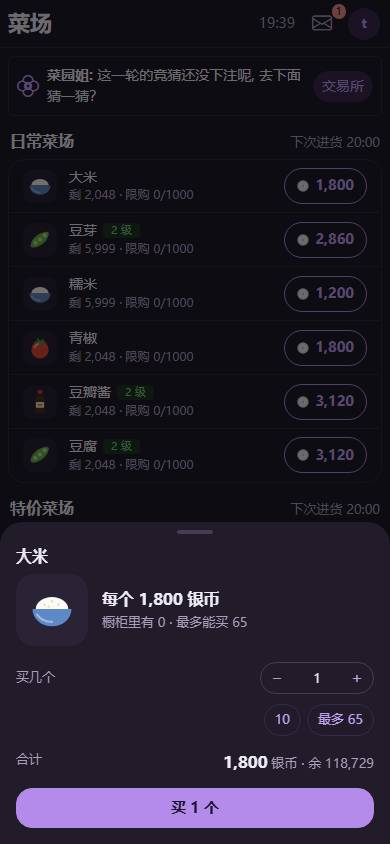

# 界面改版 P6 橱柜和菜场截图

- 日期：2026-10-11；分支 feat/ui-p6。简中 390px 浅色、深色，法文 360px。所有截图横向溢出 0。
- 开发环境的 API 还是 main 的代码：目录里没有食材类别、菜场接口没有银币。截图时按 `foods.json` 补上类别，菜场接口补上银币 118,729，才看得到食材图和余额。正式环境由新代码直接带上。
- 菜场首屏 8 行（日常 6 + 特价 2），法文 360px 也是 8 行。

| 页面 | 浅色 | 深色 | 法文 360px |
|---|---|---|---|
| 橱柜（背包格子） |  |  | |
| 橱柜（点一格的详情） |  |  |  |
| 菜场（列表） |  |  |  |
| 菜场（购买面板） |  |  | |
