# 界面改版 P7 截图（餐厅、厨具、任务、活动、食谱、仓库）

- 日期：2026-10-11；分支 feat/ui-p7。设计图：https://claude.ai/artifact/2rMTSHEYfniFtEt2nEkeP9 （用户确认后照做）。
- 简中 390px 浅色为主，几页加深色和法文 360px。所有截图横向溢出 0。
- 测试号没有厨具、特色菜：厨具页、厨具详情、特色菜截图时拦截接口补了接近 seeker 的数据（37 件、阿卡玛套装、30 道已学）。其余是测试号的真实数据。

| 页面 | 浅色 | 深色 | 法文 360px |
|---|---|---|---|
| 楼层（点一桌） | 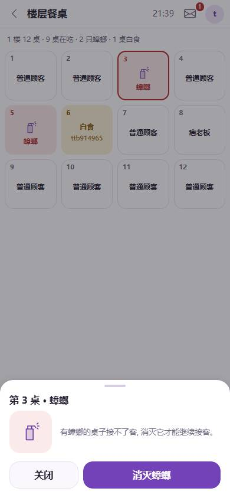 | | |
| 收益 | 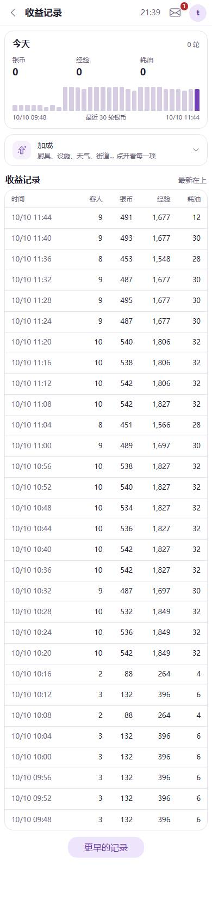 | | |
| 餐厅信息 | 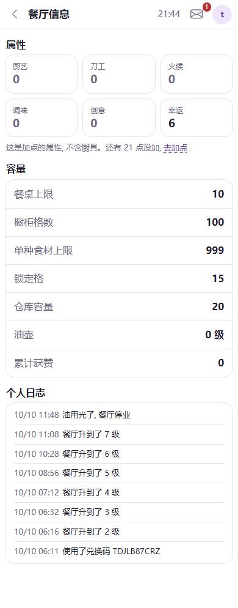 | | |
| 装扮 | 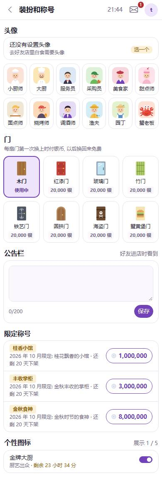 | 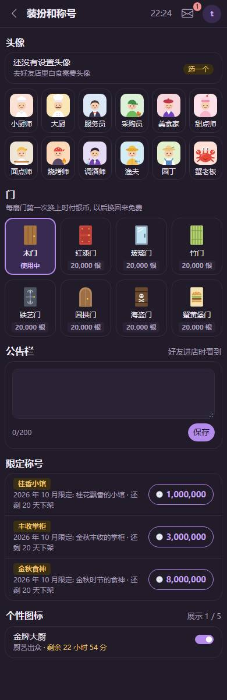 | 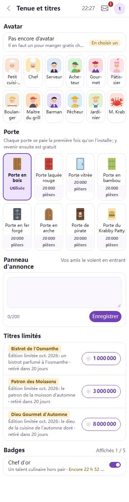 |
| 厨具 | 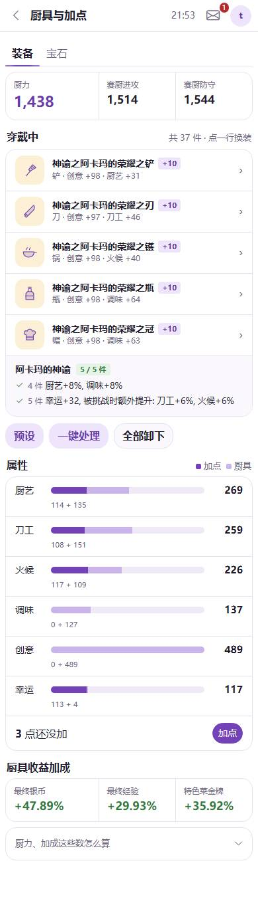 | 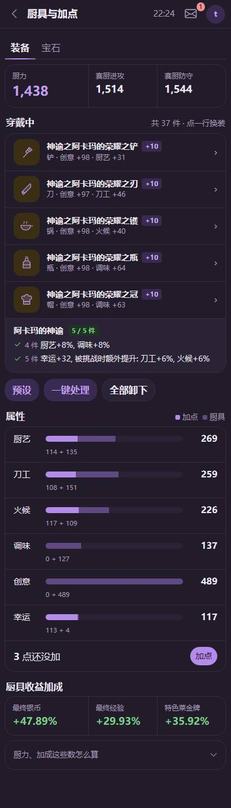 | 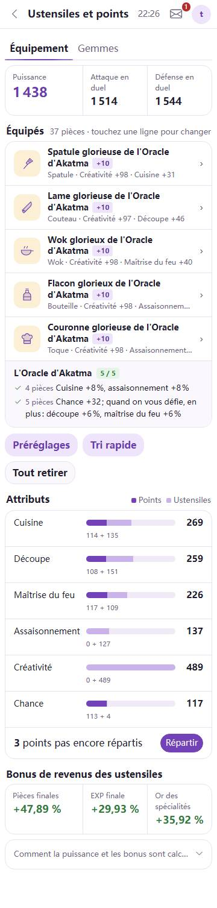 |
| 厨具·换铲 | 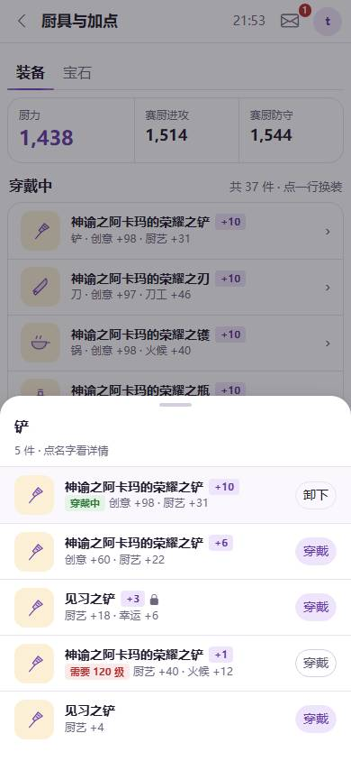 | | |
| 厨具·加点 | 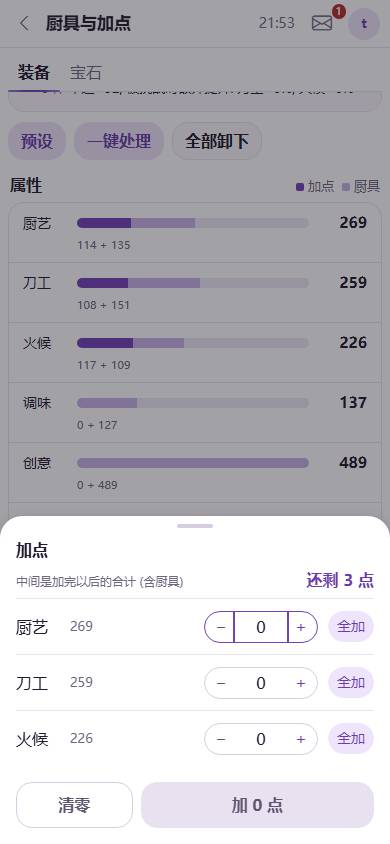 | | |
| 厨具详情 | 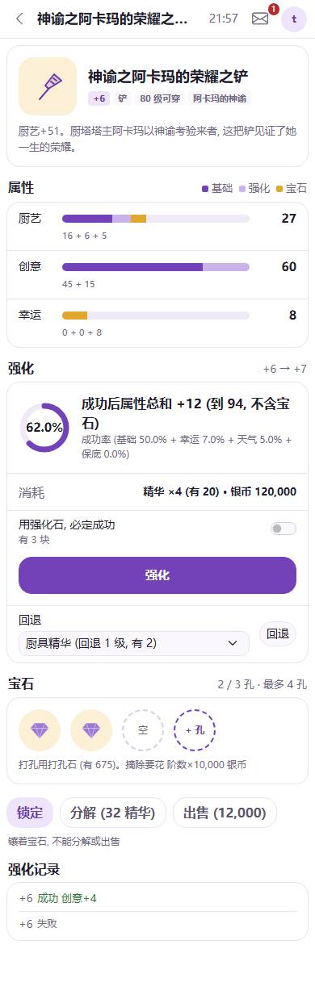 | | |
| 厨具详情·镶嵌 | 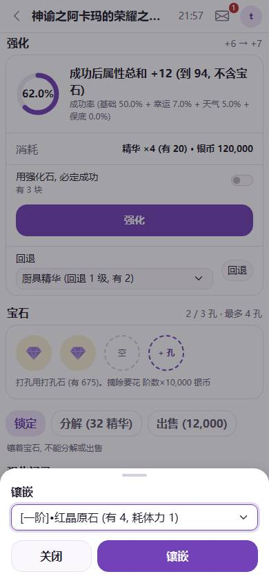 | | |
| 任务·今日 | 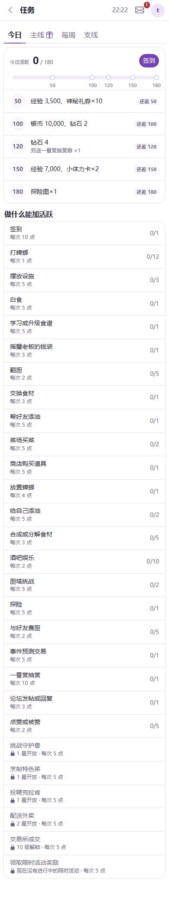 | 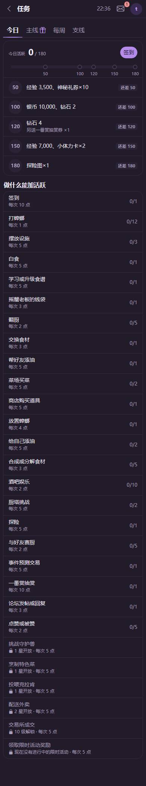 | 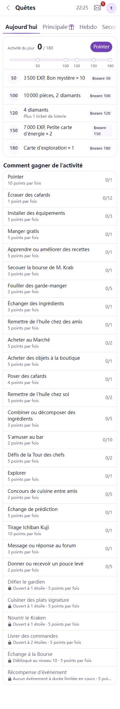 |
| 任务·主线 | 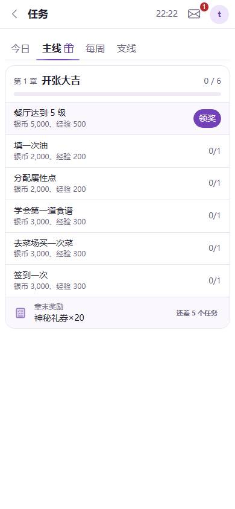 | | |
| 活动 | 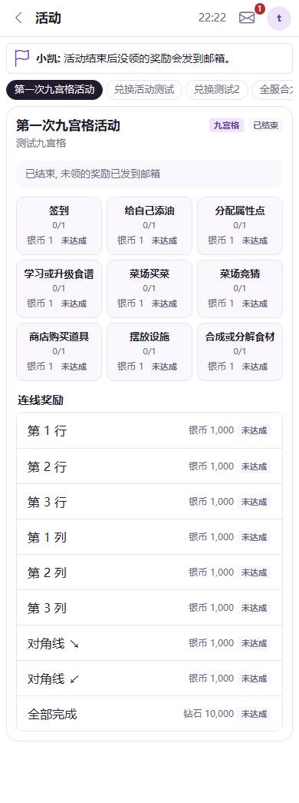 | | |
| 食谱 | 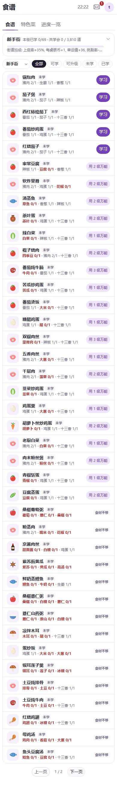 | 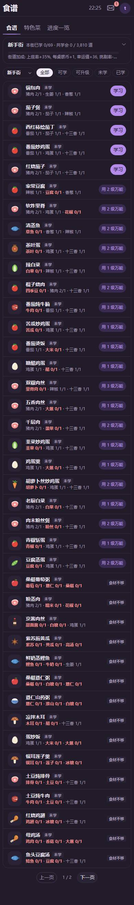 | 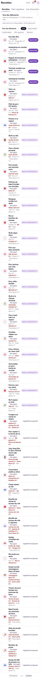 |
| 特色菜 | 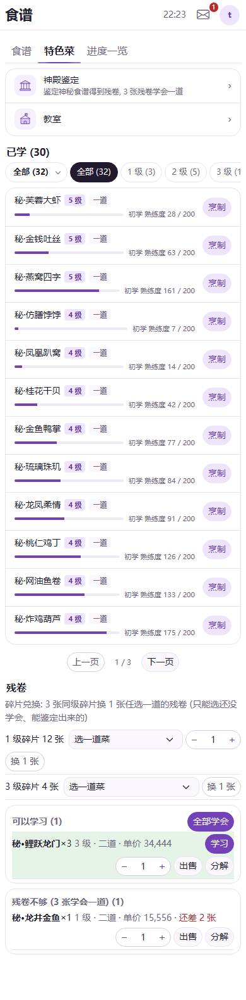 | | |
| 进度一览 | 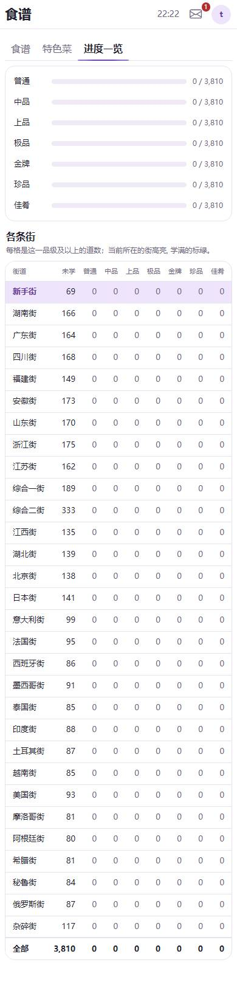 | | |
| 食谱详情 | 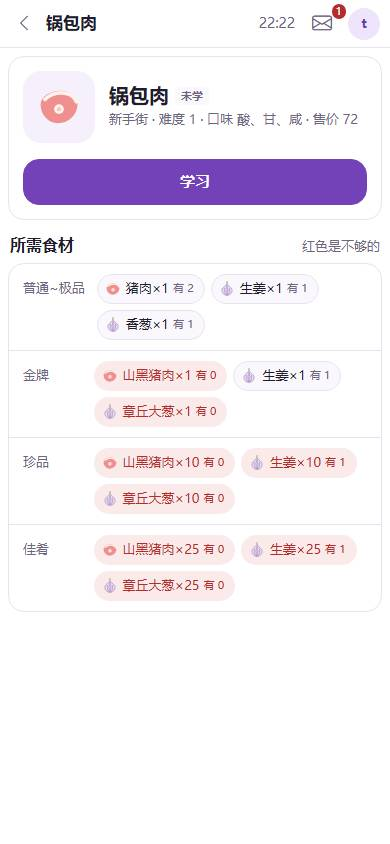 | | |
| 仓库 |  | | |
| 仓库·点一件 | 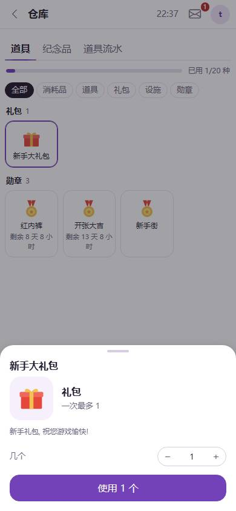 | | |

和设计图不同的地方（都是可接受的替代）：

- 加点面板只有厨艺、刀工、火候三行：游戏里只有这三项能加点（设计图画了六项）。
- 道具图形按小类给（券、卡、礼包、勋章…），同一小类的道具图一样；设计图里每件画了不同颜色。
- 楼层格子里“普通 / 挑剔”是短名小标签；测试号的普通顾客没有点菜，格子里只写顾客类型。
