# 界面改版 P8 截图（商店、交易所、收购、一番赏、事件预测、外卖、银行）

- 日期：2026-10-12；分支 feat/ui-p8。设计图：https://claude.ai/artifact/STS5yKmuVz31a81TtL8deo （用户确认后照做）。
- 简中 390px 浅色为主，几页加深色和法文 360px。所有截图横向溢出 0。
- 测试号缺的数据截图时拦截接口补了样例：嘻哈男孩今天在场、交易所盘口和我的挂单、大宗认购有我的出价、外卖已开通（单、配送、骑手、好友）。其余是测试号的真实数据。

| 页面 | 浅色 | 深色 | 法文 360px |
|---|---|---|---|
| 商店 · 银币商店 | 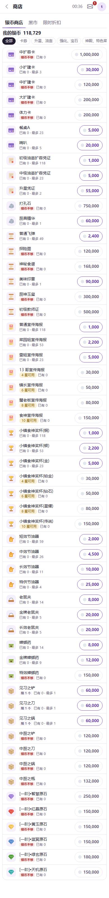 | | 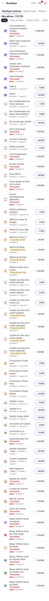 |
| 商店 · 点价格买 | 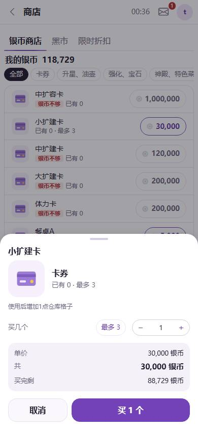 | | |
| 商店 · 限时折扣（嘻哈男孩收起） | 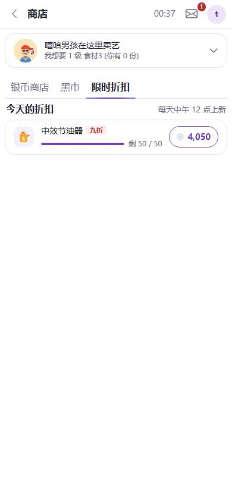 | | |
| 嘻哈男孩 · 点开打赏 | | 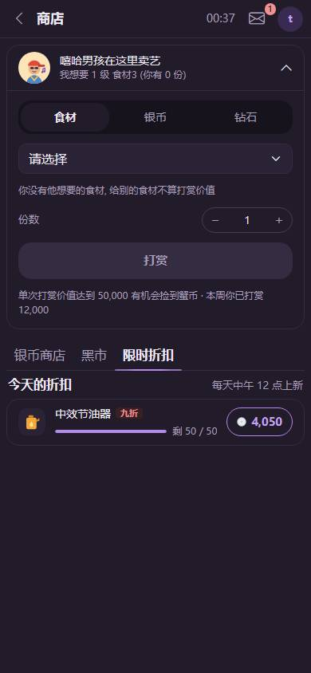 | |
| 交易所 · 现货（在售） | 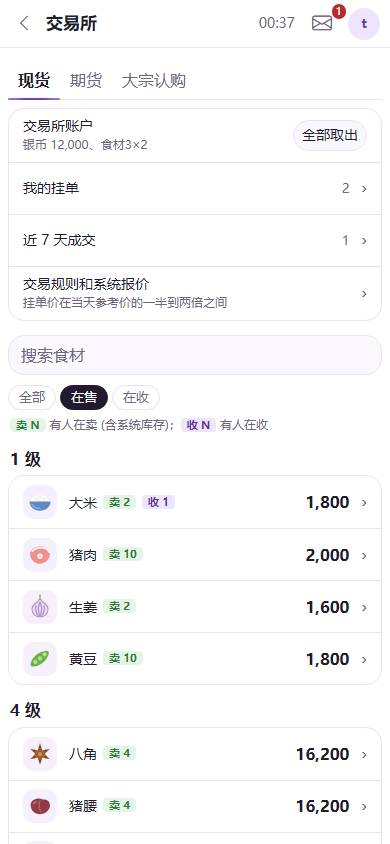 | | |
| 现货 · 盘口和下单 | 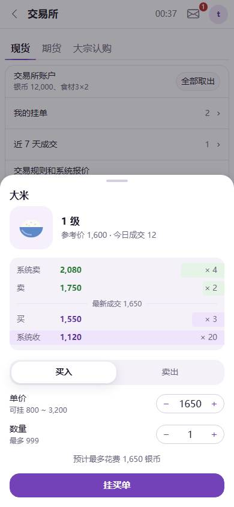 | | 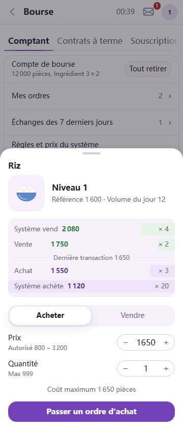 |
| 现货 · 我的挂单 | | 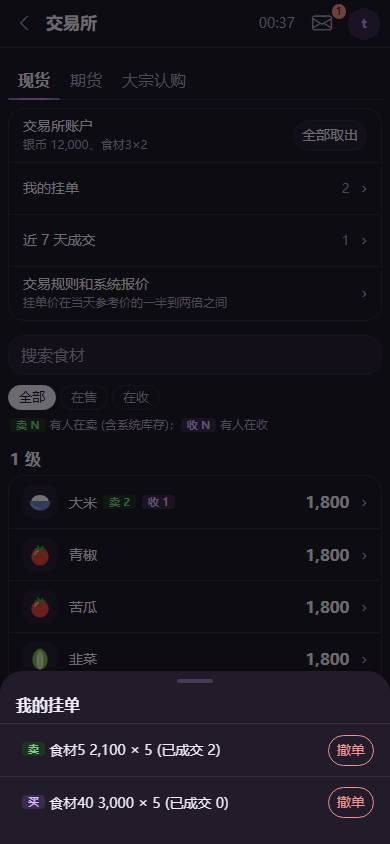 | |
| 期货（稀有） | 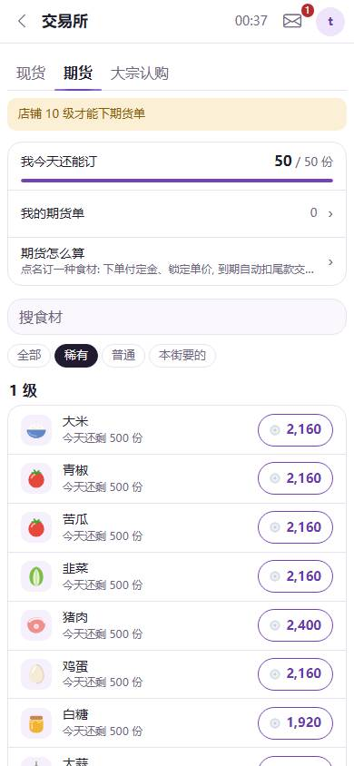 | | |
| 期货 · 下单 | 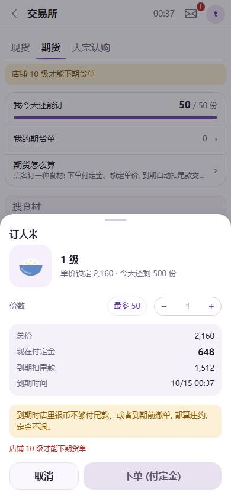 | | |
| 大宗认购 | 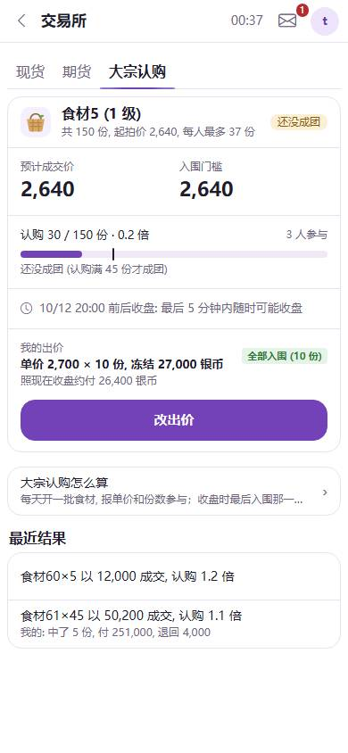 | | |
| 大宗认购 · 改出价 | | 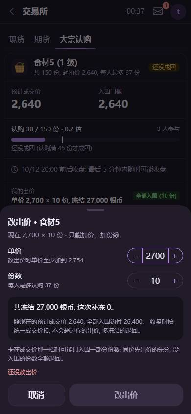 | |
| 收购 · 身价榜 | 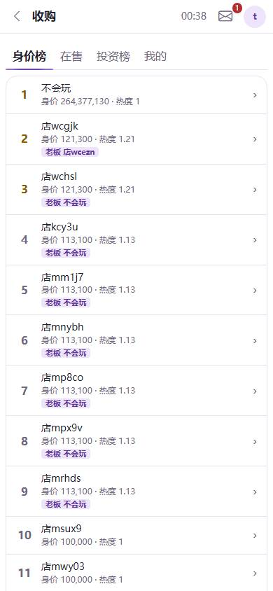 | | |
| 收购 · 点开一家 | 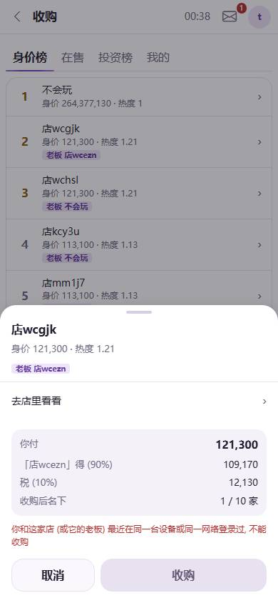 | | |
| 收购 · 投资榜 | 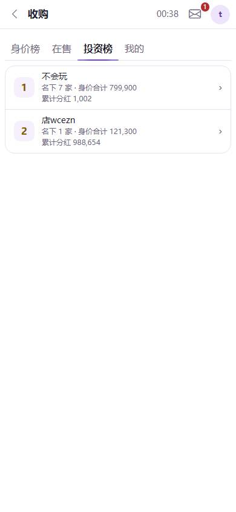 | | |
| 收购 · 我的 | | 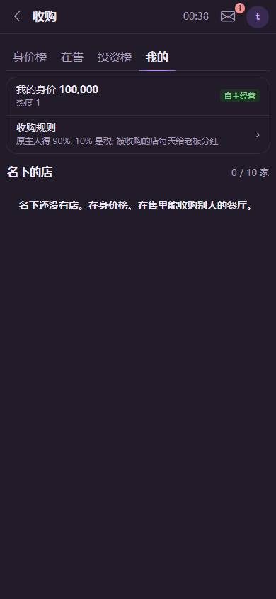 | |
| 一番赏 · 普通 | 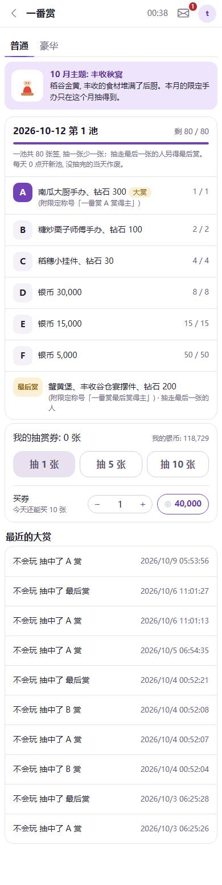 | | |
| 一番赏 · 豪华 | | 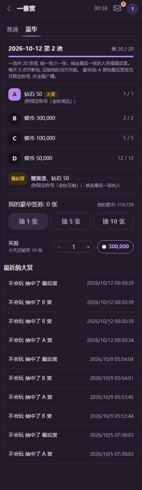 | |
| 事件预测 · 列表 | 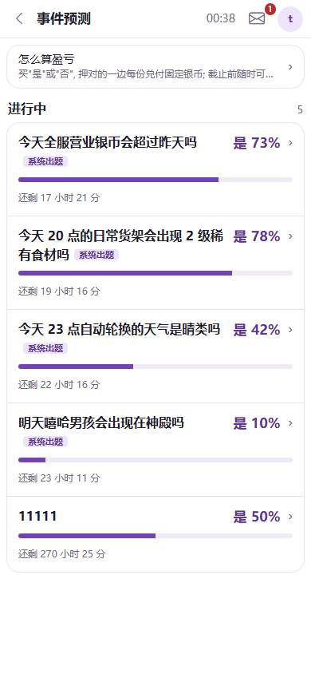 | | |
| 事件预测 · 详情页 | 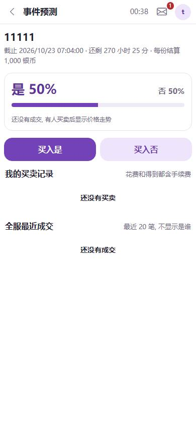 | | 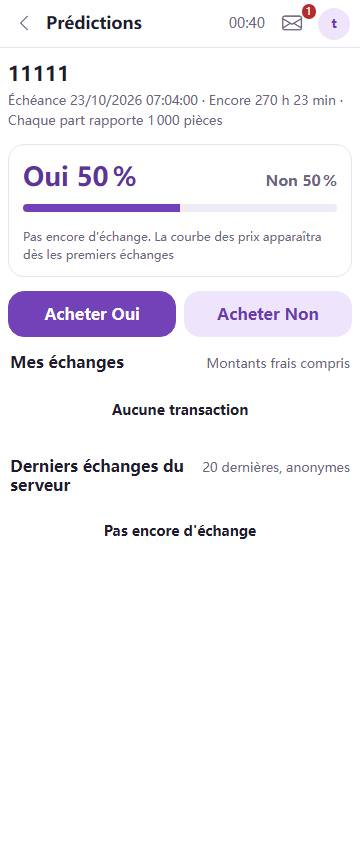 |
| 事件预测 · 买卖 | | 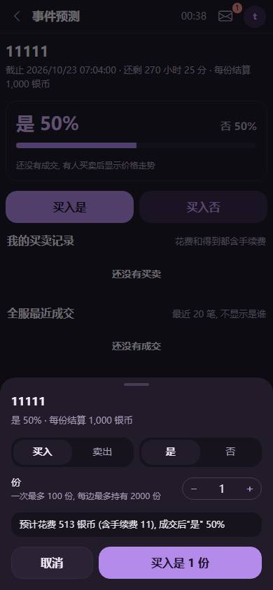 | |
| 外卖 · 没开通 | 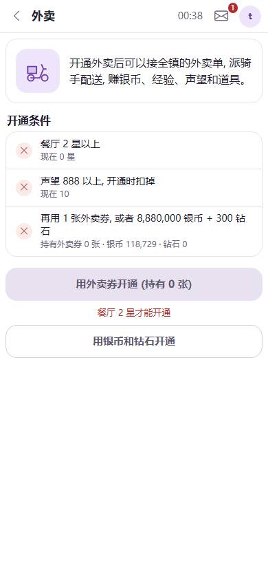 | | 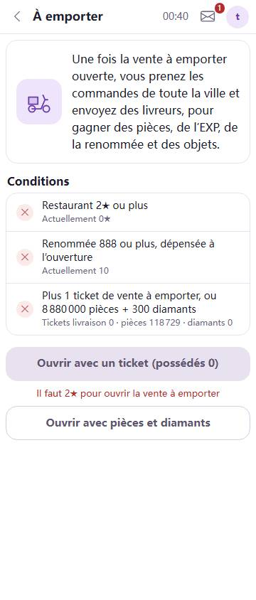 |
| 外卖 · 外卖单 | 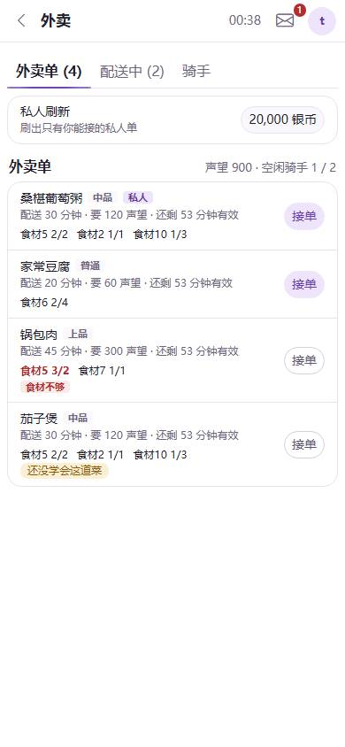 | | |
| 外卖 · 接单 | 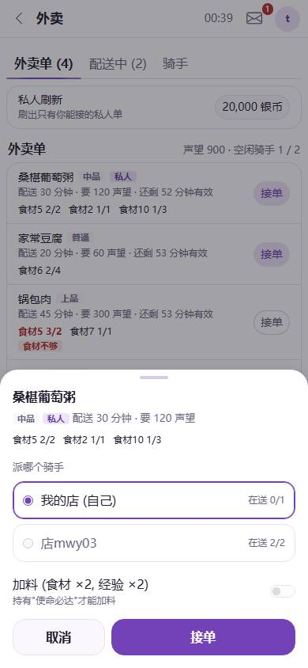 | | |
| 外卖 · 配送中 | |  | |
| 外卖 · 骑手 | 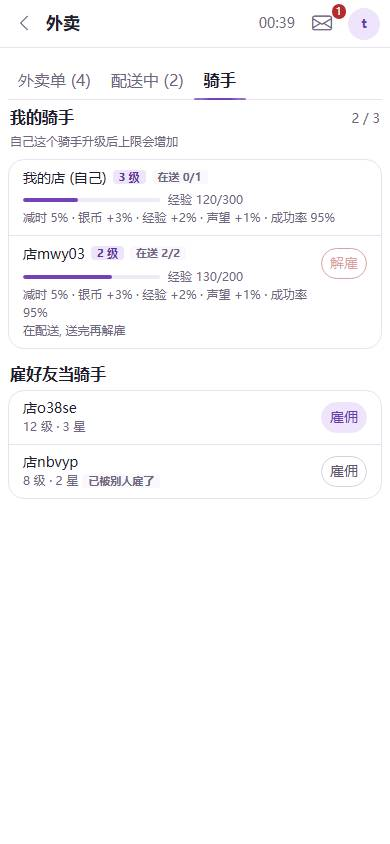 | | |
| 银行 · 基金 | 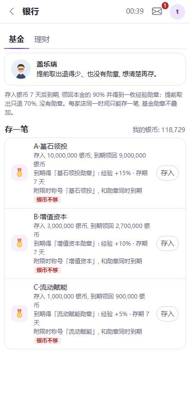 | | |
| 银行 · 理财 | | 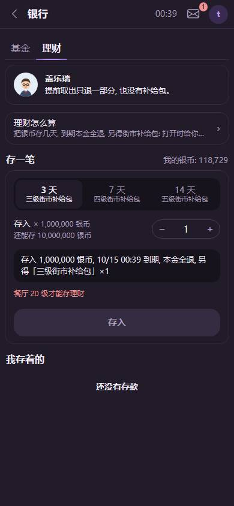 | |

和设计图不同的地方：

- 价格按钮沿用菜场的描边胶囊 `.dt-price-btn`（设计图画的是浅紫实心），和菜场保持一致。
- 限时折扣每天只有一件（接口就是一件），设计图画了两件做示意。
- 收购挂牌的比例是区服设置的下限 ~ 100%、5% 一档（设计图写了 120%、150%）。
- 收购榜单没有门的图形：榜单接口不带门，先只写名次。
- 交易所现货一共两百来种食材，全部列出时页面很长；可以用“在售 / 在收”筛选或搜索缩短。
- 外卖单要的食材写“要几 / 有几”（和原来一样），设计图里写反了。
